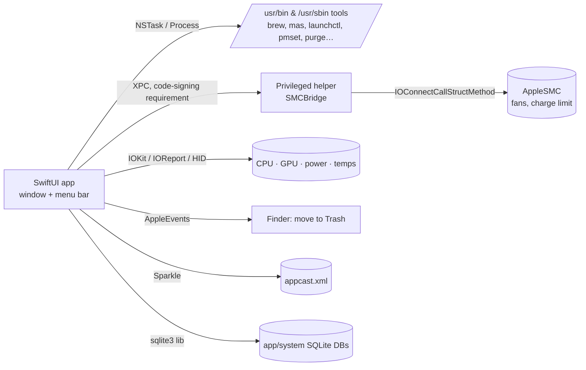

# Fresh — Reverse-Engineered Product Specification

Fresh is an all-in-one macOS maintenance app. It cleans system junk, uninstalls and
updates apps, runs maintenance, maps disk usage, and monitors the Mac live from a
window and the menu bar. This document explains how it works, from its UI design to
its internal engines, as reconstructed from the installed app.

The clean-room rebuild of this product lives in [`cfmac/`](cfmac/README.md).

> **Naming.** This document calls the product **Fresh** throughout. The analyzed build is a
> native SwiftUI app (version 1.18.0, build 343, macOS 14+, universal arm64/x86_64).
> Product-specific names such as bundle identifiers, the vendor domain and the helper
> label have been generalized to `fresh` below.

---

## Contents

1. [Sources of this analysis](#1-sources-of-this-analysis)
2. [Architecture](#2-architecture)
3. [Design language](#3-design-language)
4. [Navigation and window](#4-navigation-and-window)
5. [Clean](#5-clean)
6. [Apps (Uninstall · Updates · Startup)](#6-apps)
7. [Optimize](#7-optimize)
8. [Analyze](#8-analyze)
9. [Status](#9-status)
10. [Menu bar](#10-menu-bar)
11. [Tools: Clean Screen, Keep Screen On, Fan, Battery Care, Wi-Fi Low Latency, Doctor](#11-tools)
12. [Settings](#12-settings)
13. [Safety model](#13-safety-model)
14. [Notifications, operations queue and logs](#14-notifications-operations-queue-and-logs)
15. [Licensing, trial and updates](#15-licensing-trial-and-updates)
16. [Permissions](#16-permissions)
17. [System APIs and commands used](#17-system-apis-and-commands-used)
18. [Mapping to cfmac](#18-mapping-to-cfmac)
19. [Unknowns and limits of this analysis](#19-unknowns-and-limits-of-this-analysis)

Labels used in this document:

- **Observed**: seen directly in shipped files or the running UI.
- **Derived**: computed from observed facts, such as counts or groupings.
- **Inferred**: a reasonable reading of the evidence that was not confirmed at runtime.

---

## 1. Sources of this analysis

All analysis was read-only. The app's files were never modified, and the only interaction
with the running app was switching between its tabs.

| Source                                     | What it showed                                                                                                                       |
| ------------------------------------------ | ------------------------------------------------------------------------------------------------------------------------------------ |
| Bundle layout                              | Main executable, privileged helper tool, Sparkle framework, artwork and 11 localizations                                             |
| `Info.plist`                               | Identifier, version, URL scheme, privacy usage strings, update feed and helper signing requirement                                   |
| Mach-O load commands and imports           | Universal binary (x86_64 + arm64), minimum macOS 14.0, 53 linked libraries, 2,886 imported symbols                                   |
| Live UI                                    | Window layout, accessibility tree and appearance of the Clean, Apps, Optimize, Analyze and Status tabs                               |
| Localized strings (`en.lproj`)             | **1,569 UI strings** describing nearly every feature, state and error                                                                |
| Asset catalog (`assetutil --info`)         | Icon set, 4 named colors, ~100 custom template icons                                                                                 |
| Surviving Swift symbols (`swift demangle`) | Protocol names such as `FanSMCWriting`, `BatteryCareSMCWriting`, `AWDLInterfaceControlling`, `OptimizeInspecting`, `LicenseProvider` |
| Helper strings                             | `SMCBridge`, `FanSMCApplicator`, SMC keys for fan and charge control                                                                 |
| Bundled open source notices                | Artwork sources and licenses (Solar System Scope, NASA, RunCat, Phosphor)                                                            |

The binary is stripped and was not decompiled, so behavior is described from strings,
imports and the live UI rather than from code.

String counts by feature area (Observed):

```
software 196 · settings 119 · clean 114 · uninstall 111 · cache 105 · ai 103 · updates 88
analyze 85 · menuBar 82 · status 81 · process 66 · license 60 · optimize 50 · menu 24
doctor 22 · batteryCare 20 · fan 20 · trashRemnant 17 · notification 16 · cleanScreen 16 …
```

---

## 2. Architecture

### Bundle anatomy (Observed)

```
Fresh.app/Contents
├── MacOS/Fresh                         41 MB universal SwiftUI executable
├── Library/LaunchServices/
│   └── <id>.systemhelper               privileged helper (SMJobBless-style), SMC access
├── Frameworks/Sparkle.framework        auto-updater 2.x (Autoupdate, Updater.app, XPC services)
├── Resources/
│   ├── Assets.car                      app icon, 4 colors, ~100 template icons (24/48 px)
│   ├── earth/jupiter/mars/mercury/moon/sun .jpg|png   hero planet textures
│   ├── planet-static-*.png             non-animated planet fallbacks
│   ├── runner-*.png                    menu bar "runner" sprite sheets (cat, dog, frog, dino…)
│   ├── THIRD-PARTY-NOTICES.md
│   └── {de,en,es,fr,it,ja,ko,nl,pt-BR,zh-Hans,zh-Hant}.lproj   11 localizations
└── Info.plist
```

### Process model (Inferred from plist, imports and strings)



- **One main executable** holds every feature. There's no separate CLI binary inside the bundle.
- **Privileged helper** (`SMPrivilegedExecutables`) is installed on demand as "Fan & charging
  helper" (_Settings › Hardware Access_). It contains `SMCBridge`, `FanSMCApplicator`,
  `FanSMCWriting` and `BatteryCareSMCWriting`, plus SMC keys such as `CH0B`/`CH0C`
  (charge inhibit) and fan keys. Everything else runs as the user, or through one-off
  `osascript … with administrator privileges` prompts.
- **Sparkle 2** checks the feed automatically (`SUEnableAutomaticChecks = true`), but
  installing updates requires the user (`SUAllowsAutomaticUpdates = false`). It offers
  a stable channel and a beta channel ("Receive beta updates").
- **URL scheme** `fresh://` is registered (Observed), probably for license activation links.
- **Linked frameworks** (Observed): SwiftUI, AppKit, Combine, Observation, IOKit, CoreAudio,
  CoreMediaIO, AVFoundation (camera/mic in-use detection), Accessibility, Carbon (global
  hotkeys), ServiceManagement, Security (Authorization), SystemConfiguration (proxy, network),
  UserNotifications, SceneKit plus Metal (3-D planet rendering), CryptoKit (license), libsqlite3,
  and the private `libIOReport.dylib` (power and frequency sampling).

### Concurrency rule: one operation at a time (Observed)

Clean, Uninstall, App update, Homebrew update and Optimize are "operations." Only one runs
at a time; the others queue with _"Waiting for {operation} to finish · Starts
automatically when it finishes."_

---

## 3. Design language

Observed from the live UI of all five tabs (1200×772 window).

| Element        | Spec                                                                                                                                                                                                                                                                                 |
| -------------- | ------------------------------------------------------------------------------------------------------------------------------------------------------------------------------------------------------------------------------------------------------------------------------------ |
| Window         | 1200×772 default, hidden title bar, traffic lights over content, dark appearance                                                                                                                                                                                                     |
| Background     | A full-window **vertical gradient tinted per tab**: Clean = deep navy (`#272B40 → #1B1D2A`), Apps = maroon (`#33201F → #231718`), Optimize = charcoal (`#353130 → #222020`), Analyze = umber (`#43301F → #2B211A`), Status = olive (`#3D3420 → #2A2519`)                             |
| Tab bar        | Centered capsule (`white @ 8%`) holding a round logo plus 5 text tabs. The selected tab is a **solid white pill with black text**; the others are 75% white                                                                                                                          |
| Top-right      | A small status pill (license or activation state, with a green dot)                                                                                                                                                                                                                  |
| Hero screens   | One large **rotating 3-D planet** (~240 pt) centered in the upper half, a 28 pt bold headline, a 12 pt dimmed subline with an inline blue link ("Scan again", "Review results"), and a **white capsule primary button** (~236×46 pt, black semibold text)                            |
| Planet per tab | Clean = Earth (with a small Moon orbiting), Optimize = Mercury, Analyze = Jupiter, Status/Health = Sun. Every planet has a two-line poem, e.g. _"Mountain rain washes old dust away. / The ebbing tide leaves all things new."_ The finish button names the planet ("Rest, Mercury") |
| Cards          | Rounded 14 pt, fill `white @ 6%`, hairline `white @ 8%`. The header is an uppercase 11 pt label with an icon, plus a right-aligned chip ("M4", "Pressure high", "Wi-Fi")                                                                                                             |
| Numbers        | Large 26–28 pt bold value with a dimmed unit ("68 %", "165 GB"), a sparkline or bars beneath, and a 12 pt dim footer                                                                                                                                                                 |
| Colors         | Green `#5FB98A` (healthy, charging), red `#D46A6A` (hot process, failure), amber (warnings, "Intel"), blue (links, disk bar)                                                                                                                                                         |
| Lists          | Borderless rows with a 34 pt app icon, a 14 pt semibold title, and a 12 pt dim meta line using `·` separators. Checkboxes are right-aligned. Hover shows a `white @ 5%` row highlight                                                                                                |
| Icons          | ~100 custom monochrome template icons (`fresh.battery.75`, `fresh.cleanItems`, `fresh.cloud`, …) at 24 and 48 px                                                                                                                                                                     |
| Motion         | Planets rotate during work and pause at rest, the tab pill slides, and results animate in. "Quick uninstall" skips the completion animation                                                                                                                                          |

---

## 4. Navigation and window

- **Tabs**: `Clean · Apps · Optimize · Analyze · Status`. The window title follows the tab
  (Apps' title is "Software"). Arrow keys move between tabs (accessibility hint), and the
  menu has _Show Next Tab / Show Previous Tab_.
- **App menu**: About, License…, Check for Updates, Settings…, _Close Window to Menu Bar_.
- **Tools menu**: Run Doctor, Fan Cooling, Keep Screen On, Clean Screen.
- **Help**: Help, Report a Problem, Suggest a Feature, Contact the Author, Open Source Licenses.
- Closing the window keeps the app in the menu bar. An option makes **⌘Q close the window**
  rather than quit, and the Dock icon can be hidden while the window is closed.
- First launch shows onboarding: _"Get your Mac in order — Clean system junk, remove and update
  apps, check Mac status"_ with **Try free** and **Get started**.

---

## 5. Clean

### Flow

```
idle ──Scan──▶ scanning ("Looking for caches" → "Scanning {item}")
     ──▶ found  ("42.75 GB found" · "37.3 GB cleanable · Scan again" · [Review results])
     ──▶ review (sections, presets, per-item checkboxes)
     ──▶ cleaning ("Preparing clean" → "Still removing {x}… (Ns)")
     ──▶ result ("Done, X cleaned" + grouped outcomes)
```

### Sections (Observed: `cache.section.*`)

| Section                   | What it covers                                                                                                                                                  | What's kept                           |
| ------------------------- | --------------------------------------------------------------------------------------------------------------------------------------------------------------- | ------------------------------------- |
| System Data               | System caches, diagnostic logs, local Time Machine snapshots ("Purgeable Space")                                                                                | Backups on the backup disk            |
| App Caches & Logs         | App, browser and cloud caches, old logs                                                                                                                         | Sign-ins, browsing history            |
| Browsers                  | Browser caches                                                                                                                                                  | Cookies and sessions                  |
| Cloud Storage             | Sync caches                                                                                                                                                     | Re-sync on access                     |
| Communication             | Chat caches (WeChat, DingTalk, Slack-style apps). Expired media may be unrecoverable                                                                            |                                       |
| Design Tools              | Design-tool caches                                                                                                                                              | Project files                         |
| Developer Tools           | Xcode, SwiftPM, Node.js, Homebrew old versions, simulator caches, logs and runtimes, unavailable simulators, Android snapshots and images, stale `node_modules` | First build after cleaning is slower  |
| AI Tools                  | AI app caches, old tool versions                                                                                                                                | Conversations, projects, local models |
| Uninstalled App Leftovers | Files of deleted apps, including orphaned services                                                                                                              | User picks what to remove             |
| Logs                      | Old logs; large active logs are **truncated**, not deleted                                                                                                      |                                       |
| Trash                     | Everything in the Trash; can't be recovered                                                                                                                     |                                       |
| Manage Separately         | Size only, never cleaned: iOS backups, VMs, local models, other accounts, iCloud Drive local copies, installer downloads                                        | Managed in the owning app             |

Notable item types (Observed `cache.label.*`): Saved App States, Icon Cache, Crash Reports,
Memory Exception Reports, Power Logs, Unified Logs (_"permanently erase stored system logs"_),
macOS Install Data, Aerial wallpaper videos, Wallpaper render cache, Media Analysis cache,
Memoji cache, Sparkle update leftovers, updater staging leftovers, Xcode device install deltas,
Xcode data for deleted projects, Instruments recordings, and `%@ Build Files` for global
package managers.

### Safety levels per item

| Level       | Meaning                                       | Default      |
| ----------- | --------------------------------------------- | ------------ |
| **Safe**    | Regenerable caches or logs                    | Selected     |
| **Review**  | May hold app data or dev files you still need | Not selected |
| **Manual**  | Fresh never deletes it; shown for awareness   | No checkbox  |
| **Blocked** | Protected by clean policy; never shown        | n/a          |

### Review screen

- Presets: **Recommended / All / None**, plus _Restore recommended_ and _Clear selection_.
- Per section: "_n/m selected_" and _Show N more_.
- Footer summary: "_X cleanable · Y free after_". The button reads "_Move X to Trash_" or
  "_Permanently clean X_", depending on the setting.
- Row context menu: _Reveal in Finder, Copy Path, Never Clean This, Never Clean Any "{name}"
  Folders_, and _Never Clean This Type_ (rule-based exclusions, undoable inline).
- iCloud-synced folders warn: _"deleting also removes it from your other devices."_
- **Running apps**: if an app is using a cache, the row shows _In use_ and a _Quit / Force Quit_
  control ("{app} is using this cache"). Several holders collapse to "_{app} and others: N apps
  holding cache_".
- **Parallels VM reclaim** is a special action that compacts a shut-down VM disk
  ("Reclaim Space"), with checks for disk in use, layout and whether the VM changed since review.

### Result groups (Observed `clean.result.group.*`)

`Cleaned` · `Moved to Trash` · `Skipped: running app` · `Skipped: whitelist` ·
`Skipped: protected path` · `Skipped: permission` · `Skipped: missing or empty` ·
`Failed` · `Failed: handle in Finder` · `Disk Access needed`.

Skip reasons include: _Already gone_, _App is running_, _{owner} is running_, _Installer state
changed since the scan_, _An update started since the scan_, _Empty iCloud placeholder that macOS
can't remove_, and _No cleanup step for this path_. Failure reasons include _Locked_,
_Not writable by your account_ and _Owned by root_.

The result also shows a playful storage value: _"At Apple's upgrade price of $X per TB, Y is
worth about $Z."_

### AI Tool Cleanup & Care (sub-screen of Clean)

A dedicated entry ("AI Tool Cleanup & Care", which can be hidden in Settings) scans the data of
AI coding tools (Claude Code, Codex, Cursor, Copilot, OpenCode, Hugging Face, LM Studio, Ollama,
and others). It has three bands:

1. **Caches and old versions**: safe and rebuildable.
2. **Chats and worktrees**: reviewed one by one, with a retention filter (_Older than N days_,
   _Don't list_). Data in use by a running tool is held back.
3. **Unused tools and maintenance**: uninstall tools, remove leftovers, compact databases.

Completion copy: "_{X} cleaned — caches, old builds, chats, worktrees, local models_".

### Uninstalled-app leftover watcher (Observed `trashRemnant.*`)

When the user drags an app to the Trash, Fresh notices and offers "_Clean {size}_" of
leftovers. Homebrew-installed apps are cleaned through Homebrew ("_Removed from Homebrew and
ready to reinstall_"). Per-app muting is available, and on the trial this feature is metered.

---

## 6. Apps

The segmented control has three segments: **Uninstall · Updates · Startup**, plus a refresh
button, sort options (_Name, App size, Last Used, Installed_, ascending or descending), and
search (⌘F).

### Uninstall

- The list header reads "_Installed Apps · 21 apps · 15.32 GB_". Each row shows the icon, name,
  then `version · size · {data size} data · activity {relative}` or _active now_ (green), plus
  an _Intel_ tag (amber) for Intel-only binaries.
- **Vendor-managed software** (VPN or endpoint security, e.g. Cisco Secure Client, ESET,
  Adobe) shows **Uninstall instructions** or **Official uninstaller** instead of a checkbox:
  _"Fresh will not remove {app} directly."_
- Filters: All, Running, Outdated, Up to Date, Homebrew, External (other volume), Manageable,
  Settings, Unknown.
- **Detail view** (click a row): the application row (uncheck it to "_Keep App, Clear Data
  Only_"), then a paged list of associated data.
- **Remnant confidence**: _Auto_ (strong match, pre-selected) or _Review_ (may hold data you
  want to keep).
- **Evidence types** for each remnant: Bundle ID, Base bundle ID, Embedded bundle ID, Team ID,
  Team-prefixed container, Group container, Installer/Package receipt, Homebrew zap, Launch item,
  Spotlight metadata, Vendor folder, Company name, Name match, Plugin, Service, Runtime family,
  Temporary cache (name), Linked leftover, Deep review.
- **Remnant kinds**: App Support, Caches, Containers, Group Containers, Preferences, Synced
  Preferences, Saved State, Logs, Crash Reports, Cookies, HTTP Storage, WebKit, Launch
  Agents/Daemons, Helper Tools, Kernel/System Extensions, Plugins (audio, browser, QuickLook),
  Preference Panes, Screen Savers, Input Methods, Color Pickers, Dictionaries, Automator
  actions, Receipts, and Electron, JetBrains, VS Code, Docker and Android caches.
- **Advisories**: Data-heavy app (vaults, projects, VPN profiles, databases, AI workspaces),
  active Input Method, Local Network permission leftovers, and a System Extension that may remain.
- **Browser protection**: personal data (bookmarks, history, passwords) is _kept by default_ and
  removed only when selected individually. Sensitive data (wallet, key or extension data) gets
  extra confirmation. Shared or system data is never removed.
- **Process**: quit (or force quit) the app, prefer `brew uninstall --zap` for Homebrew casks
  (falling back to Trash on timeout, shared cask, or needs-admin), move the bundle and selected
  data to Trash, and report "_Left in configuration files — Fresh doesn't edit these files_".
- Failure states: needs admin, managed by enterprise, needs a manual uninstall, running, updated
  mid-way, no permission.

### Updates

- Sources: **Homebrew formulae and casks**, **Mac App Store** (relocating and staging MAS
  packages through the helper), and **Sparkle-based apps** (direct installer download).
- Sections: _Updates Available_, _Up to Date Apps_, _Hidden Updates (n)_.
- Per-row status: Fetching, Downloading %, Installing, Queued, Updating x/y. Actions: _Update
  Packages (n)_, _Ignore Updates_, _Download_, _Open in App Store_, _Continue update_.
- When an update needs the app to quit: "_Updating requires temporarily quitting {app}._" If
  macOS blocks the replacement, Fresh asks the user to enable **App Management** in Privacy settings.

### Startup

- Reads **all background items** with `sfltool dumpbtm` (needs admin once, through the helper)
  and `launchctl print`.
- Groups: _Login items_, _Allow in the background_, _Background services_ (protected),
  _System Settings_.
- Kinds: App, Login item, User/System background service (LaunchAgent/LaunchDaemon), App
  helper service (XPC), Developer, Helper.
- Policy per item: _Manageable_, _Protected_ (Apple system item, vendor/security service,
  bundled inside an app, invalid label), _Review only_, or _Manage in Settings_.
- Actions: Enable/Disable, Allow/Block startup, Move to Trash (restorable). A _Missing program_
  badge marks entries whose executable no longer exists.

---

## 7. Optimize

A hero screen (Mercury) with **Optimize** runs grouped maintenance tasks, then shows
_"Maintenance complete · N maintenance tasks completed · Review results"_.

| Group                  | Tasks (Observed `optimize.task.*`)                                                                                                                                                                                                      |
| ---------------------- | --------------------------------------------------------------------------------------------------------------------------------------------------------------------------------------------------------------------------------------- |
| **Launch speed**       | Rebuild QuickLook cache · Rebuild file thumbnails · Clear old saved window states · Remove broken background services · Remove broken login items · Restore app sleep and disk image checks                                             |
| **System databases**   | Clear old notification records · Compact Mail and Messages data (SQLite VACUUM) · Clear download quarantine history · Repair corrupted preference files · Clean orphaned Spotlight rules · Remove broken recent and sidebar lists       |
| **Network & search**   | Network and Spotlight refresh (DNS flush inferred)                                                                                                                                                                                      |
| **System maintenance** | Run periodic system maintenance (`periodic daily weekly monthly`) · Purge inactive physical memory (`purge`) · Repair disk permissions (`diskutil resetUserPermissions`) · Eject idle disk images · Check commands left by removed apps |

- **Skip logic**: _Memory pressure is normal_ (purge is skipped), _System state is normal_,
  _In your optimize whitelist_, _{tool} is not available_, _An external disk is not mounted_.
- **Admin**: all root tasks share one prompt ("Requesting admin access…"). If it's declined,
  the result reads _Admin access not granted_.
- **Glitch fixes** (repair section): restart _Spotlight_, _Notification Center_, _Input switching_,
  _Universal Clipboard_, each reporting _Normal_ or _Refreshed_.

---

## 8. Analyze

Layout (Observed screenshot):

```
┌───────────────┬───────────────────────────────────────────────────────────────┐
│  (Jupiter)    │ Whole Disk › Users/me            ▬▬▬ Files 285 GB · Used 377/494 GB ⟳│
│ 4 items·285GB │ ┌───────────────────────────────────────┐┌──────────────┐ │
│ This Folder | │ │                                       ││ Applications │ │
│ Largest Files │ │            Users/me 243 GB            │├──────────────┤ │
│ ▸ Users/me    │ │                                       ││     opt      │ │
│ ▸ Applications│ │                                       │├──────────────┤ │
│ ▸ opt ≥14 GB  │ └───────────────────────────────────────┘│   Library    │ │
│ ▸ Library     │                                          └──────────────┘ │
└───────────────┴───────────────────────────────────────────────────────────────┘
```

- **Treemap** (squarified, earthy palette) on the right, sidebar list on the left with
  _This Folder / Largest Files_. Breadcrumb ("Whole Disk › …") with collapsed middle crumbs.
- **Sizing is progressive** and time-budgeted: an entry shows _Queued_, _Sizing_,
  _Sizing · X_, _≥ X_ (a partial floor when part of a folder couldn't be read in time), or
  _About X_ (parent estimate). Slow folders are retried with a longer timeout.
- **Honest totals**: "File total" against "Used" (which matches System Settings). APFS clones
  can make file totals exceed usage. Purgeable space and hidden system areas (`/System`,
  `/private`, `/var`, other volumes, snapshots) are explained in tooltips.
- **Growth insight**: "_Up X since {date}_" and "_Another X in System Data_".
- **Kinds**: Folder, Hidden Folder, App/installer, Archive, Audio, Backup, Data, Design,
  Dev files, Disk image, Documents, Images, Videos, Alias, Other.
- **Actions**: right-click → Move to Trash, Delete Permanently (for items already in
  Trash), Reveal/Open in Finder, _Review cleanable items_ (jumps to Clean). Top-level system
  and home folders can't be trashed.
- Scan results are cached ("_Scanned {time}_", "_Refreshing · scanned {time}_").

---

## 9. Status

An 8-card grid over a process table (Observed screenshot and accessibility tree):

| Card           | Content                                                                                                                                                          |
| -------------- | ---------------------------------------------------------------------------------------------------------------------------------------------------------------- |
| **Health**     | Score 0–100 plus a label (_Excellent / Good / Fair / Needs Attention_), chips for chip/RAM/macOS, the top penalty ("CPU load high"), uptime, and an animated Sun |
| **CPU**        | Total %, per-core bar chart (sorted), temperature chip, "busy · 10 cores · Load avg 12.5"                                                                        |
| **GPU**        | %, temperature, sparkline, power in W                                                                                                                            |
| **Memory**     | %, pressure chip (_normal / high / critical_), area sparkline, "12.51 GB · 1.56 GB swap", and a breakdown (App, Wired, Compressed)                               |
| **Battery**    | %, adapter watts, health chip, charging/system power, accessory batteries (Bluetooth rings), and _Top drain now {process}_                                       |
| **Free space** | Free GB, total chip, usage bar, live read/write throughput                                                                                                       |
| **Network**    | Download rate, interface chip, sparkline, upload, a **Low Lag** toggle (Wi-Fi low latency), and IP/proxy details                                                 |
| **Fan**        | RPM, _Auto / Cool / Max_ modes, "Managed by macOS"                                                                                                               |

**Health score** = 100 − penalties. Observed factors: _CPU load high, Memory pressure, Disk
space low, Heavy disk I/O, Running warm, Battery health low, Battery aging, Long time since
restart, Drive failure risk detected_, each rendered as "_{factor}, −N pts_".

**Process table**: NAME (count) · MEM · %CPU (bar, red when sustained high) · PWR (power score) ·
PID · `⋯`. Rows show app icons, owner hints ("Part of {app}", "Subprocess: {x}"), and pinning.
Actions: _Terminate, Force Quit, Reveal in Finder, Copy Process Name, Copy PID, Pin Row_.

**"Why is this running?"** (process explain panel):

- _Why it exists_: started by a parent, a terminal session, SSH, or kept alive by launchd (with
  service label, plist, KeepAlive and launchd reason).
- _Members_ (process tree), _Triggers_, _Listening ports_, _Open files_, _Disk I/O_,
  _Threads_, _Working directory_, _Git repo_, _Command_.
- **Warnings**: running as root, listening on a public interface, prevents sleep, DYLD
  injection variables set, binary deleted/replaced while running, running over 90 days,
  suspended, zombie, unknown source.
- Safe termination: PID-reuse detection (_"Refresh and retry because process N changed"_)
  and protected system processes.

---

## 10. Menu bar

- **Display modes**: _Icon_, _Live data_, or _Icon and data_. Layout is _Columns_ or _Stacked_.
- **Metric slots** (up to three): CPU, GPU, Memory, Pressure, Swap, Disk, Battery level or time,
  Accessory battery, Power draw, Chip temperature, Fan speed, plus live network speed.
- **Runner character**: an animated sprite (cat, dog, frog, rabbit, dinosaur, horse,
  rubber duck, and others) that **runs faster as CPU load rises**. It can be static and
  flipped left or right.
- **Panel**: status cards, _Top Processes_ (sortable) with one-click _Stop_ (protected classes:
  System, Security, Network, System port), camera/mic privacy indicator, quick actions
  (**Awake** with durations, **Screen** = Clean Screen, **Eject** all disks), the _Open at
  login_ chip, and a lifetime footer ("_Cleaned X · N× optimized_", "_Last clean …_").
- Left/right click can be swapped (tools vs status).

---

## 11. Tools

| Tool                        | Behavior                                                                                                                                                                                                                                                                                                                                                                   |
| --------------------------- | -------------------------------------------------------------------------------------------------------------------------------------------------------------------------------------------------------------------------------------------------------------------------------------------------------------------------------------------------------------------------- |
| **Clean Screen**            | Blacks out displays and locks the keyboard for wiping. Durations are 1/2/5 min or manual. Uses **Accessibility** to also block brightness, volume, function and Dictation keys. Exit by holding a shortcut. Footer: "_Screen and keyboard locked · exits in 1:00 · Press ⌥⌘L to exit_"                                                                                     |
| **Keep Screen On (Awake)**  | Modes: _Screen only_, _Screen and tasks_ (runs with lid closed via `pmset disablesleep`), _Tasks only_. Durations or _Until stopped_. Pauses at low battery and resumes on power. Optional coffee-cup menu bar icon                                                                                                                                                        |
| **Fan Cooling**             | _Auto_ (macOS), _Cool_ (starts at N% and ramps with heat), _Max_. Written to the SMC through the helper. Auto-returns after cooling. Refuses to quit if it can't confirm fans are back on Auto                                                                                                                                                                             |
| **Battery Care**            | Holds charge near **80%** via SMC charge inhibit (helper). _Charge to 100%_ overrides once; _Resume 80% limit_ undoes that. Defers to the system limit when macOS manages charging                                                                                                                                                                                         |
| **Wi-Fi Low Latency**       | Temporarily disables AWDL (AirDrop, iPhone Mirroring) to cut Wi-Fi jitter. Restores state when the network changes                                                                                                                                                                                                                                                         |
| **Doctor**                  | Report sections: SYSTEM, ENVIRONMENT, CONFIGURATION, PERMISSIONS, SECURITY, RUNTIME, DETECTED ISSUES. Detected issues include disk ≥90% full, Disk Access off, memory pressure, battery health or cycles, Trash over 5 GB, a reboot suggestion when a process hogs CPU after long uptime, and an unwritable operations log. _Copy Report_, _Show Operations Log in Finder_ |
| **Privacy alerts**          | Notifications when the camera or mic starts being used (CoreMediaIO and CoreAudio listeners), muteable per app                                                                                                                                                                                                                                                             |
| **Bluetooth battery alert** | Alerts below 20% for headphones, mice and keyboards                                                                                                                                                                                                                                                                                                                        |

---

## 12. Settings

Tabs: **General · Tools · Menu Bar**. Sections (Observed `settings.section.*`):

- **App Preferences**: Launch at login, Language (11), Hide Dock icon, ⌘Q closes the window,
  Quick uninstall (skip animation), Remove data and settings with apps, Show AI cleanup entry.
- **Cleaning**: Cache removal (_Move to Trash_ or _Delete permanently_; app removal always uses
  Trash), Items excluded from cleaning (_Allow in next cleanup_).
- **Notifications**: Low disk space (below 10% _and_ 30 GB, once), camera/mic alerts with muted
  apps list, Bluetooth low battery, leftover alerts with a muted apps list.
- **Menu Bar**: show in menu bar, content mode, data layout, three metric slots, live network
  speed, runner character, swap clicks.
- **Screen**: Keep Screen On mode, indicator icon, Clean Screen duration.
- **Battery**: charging protection.
- **Shortcuts**: global hotkeys (Carbon) for the main window, menu bar panel, Clean Screen,
  Keep Screen On and Fan cooling. Two or more modifiers are required, and conflicts are detected
  ("_Used by {app}_").
- **System Permissions**: Disk Access, Accessibility for Clean Screen.
- **Hardware Access**: install, reinstall or remove the Fan & charging helper.
- **Updates & license**: beta updates, license and activated devices.

---

## 13. Safety model

Every deletion passes a path guard (Observed `guard.reason.*`). It refuses paths that are:

| Reason                                                                     | Rule                                        |
| -------------------------------------------------------------------------- | ------------------------------------------- |
| Empty path / Not an absolute path                                          | Basic validation                            |
| Path contains control characters                                           | Rejects injection                           |
| Path steps outside its own tree                                            | `..` traversal                              |
| Critical system path, left alone                                           | `/System`, `/usr`, `/bin`, top-level dirs   |
| Protected app data, left alone                                             | Keychains, TCC, Mail, Messages, and similar |
| User data, kept during uninstall                                           | Documents-like data in containers           |
| Not cleaning through a symbolic link / Link points to a protected location | No symlink traversal                        |
| On your protected list                                                     | User whitelist ("Never Clean This")         |

It also re-validates state at clean time. If anything changed after review, it reports
_"The item changed after the review"_, _"{owner} started after the review"_, or
_"Installer state changed since the scan"_. The Trash itself is checked (a symlinked or unreadable
Trash is refused). Logs that are still open are truncated rather than deleted. When an admin step
is needed, the helper moves items and reports _"The move with admin rights did not go through"_.

---

## 14. Notifications, operations queue and logs

- An **operations log** on disk records every clean, uninstall and optimize. Doctor can reveal it
  and flags it if it can't be written.
- **Lifetime counters** drive the menu bar footer and the "Lifetime" card.
- Notification types: low disk, Keep Screen On started, ended, paused or resumed, camera/mic in use,
  Bluetooth accessory low battery, Wi-Fi low latency on.

---

## 15. Licensing, trial and updates

- **Trial**: limited free uses ("_1 free use left_"). Leftover cleaning after drag-to-Trash is
  metered ("_Free trial used up_").
- **License**: activation by key, recovery of purchased licenses, and an _Activated devices_
  list with a device limit. Keychain-backed (`KeychainBacking`) with a trial file
  (`TrialFileBacking`), verified with CryptoKit.
- **Updates**: Sparkle feed with an EdDSA public key; stable and beta channels.

---

## 16. Permissions

| Permission                      | Why                                                                                                                                     |
| ------------------------------- | --------------------------------------------------------------------------------------------------------------------------------------- |
| Full Disk Access                | Reach caches, leftovers and containers behind TCC. Without it, a banner reads "_Enable disk access so Fresh can clean more thoroughly_" |
| Desktop / Documents / Downloads | Scan for leftover installer files                                                                                                       |
| Apple Events                    | Ask Finder to move apps to Trash and remove login items during uninstall                                                                |
| Administrator                   | Optional maintenance, startup-item listing, helper install                                                                              |
| Accessibility                   | Clean Screen key blocking                                                                                                               |
| App Management                  | Replacing apps during updates                                                                                                           |
| Notifications                   | Alerts listed above                                                                                                                     |

---

## 17. System APIs and commands used

**APIs** (Observed imports): `host_processor_info`/`host_statistics64` (CPU, memory),
`IOPSCopyPowerSourcesInfo` and `AppleSmartBattery` (battery), `IOHIDEventSystemClient` (thermal
sensors), `libIOReport` (power and frequencies), `IOConnectCallStructMethod` (SMC via helper),
`IOPMAssertionCreateWithName` (Awake), `CGEventTapCreate` (Clean Screen key blocking),
`CMIOObject*`/`AudioObject*` property listeners (camera/mic in use), `MDItemCopyAttribute`
(last-used dates), `LSRegisterURL`, `AuthorizationCreate`/`CopyRights`, `SMAppService`,
`NSWorkspace` mount/unmount, `CFNetworkCopySystemProxySettings`, `UNUserNotificationCenter`.

**Commands** (Observed strings): `brew` (outdated, upgrade, uninstall --zap), `mas`, `launchctl`
(print, bootout, bootstrap, enable, disable), `sfltool dumpbtm`, `pmset -a disablesleep`,
`purge`, `periodic daily weekly monthly`, `diskutil resetUserPermissions`, `hdiutil`,
`qlmanage -r`, `lsregister`, `dscacheutil`, `sqlite3`, `softwareupdate`, `codesign`,
`pkgutil`, `installer`, `system_profiler`, `memory_pressure`, `killall`, `osascript`,
`PlistBuddy`, `defaults`, `xcrun simctl`, `xcode-select`.

---

## 18. Mapping to cfmac

cfmac is a clean-room rebuild: none of Fresh's code, binaries, poems or custom icons are used.
Its artwork comes from the same openly licensed upstream sources Fresh credits, downloaded
from those sources rather than copied from Fresh: Solar System Scope planet textures
(CC BY 4.0) rendered as 3D spheres, and the RunCatNeo menu bar runner (Apache 2.0).
Interface icons are SF Symbols. See `cfmac/NOTICES.md`.

| Fresh feature                                                                                            | cfmac | Notes                                                                                           |
| -------------------------------------------------------------------------------------------------------- | ----- | ----------------------------------------------------------------------------------------------- |
| Per-tab tinted gradients, pill tab bar, 3D planet heroes, white capsule CTA, card grid                   | ✅    | Earth with orbiting Moon (Clean), Mercury (Optimize), Jupiter (Analyze), Sun (Health)           |
| Animations: sliding tab pill, spinning planets (faster while working), counting numbers, staggered cards | ✅    | SceneKit planets; SwiftUI transitions                                                           |
| Clean: scan → found → review → clean → result                                                            | ✅    | 11 sections, Safe/Review/Look Up, presets, _Never Clean This_, _In use + Quit_, grouped results  |
| Chromium/Electron cache discovery, leftovers of removed apps, Trash, size-only items                     | ✅    | Container leftovers only with Full Disk Access                                                  |
| AI Tool Cleanup sub-screen, VM reclaim, log truncation, Time Machine snapshots                           | ❌    | AI caches appear as a Clean section instead                                                     |
| Apps · Uninstall with leftovers (Auto/Review, evidence) and keep-app/clear-data                          | ✅    | Bundle-ID and name evidence; Finder fallback for root-owned apps                                |
| Official-uninstaller vendors                                                                             | ✅    | Prefix list                                                                                     |
| Apps · Updates                                                                                           | ✅    | Homebrew formulae/casks and `mas`; no Sparkle-app updates                                       |
| Apps · Startup                                                                                           | ✅    | LaunchAgents/Daemons via `launchctl`; login items open System Settings (no `sfltool`)           |
| Optimize: hero screen, groups, single admin prompt, skip logic, glitch fixes                             | ✅    | 8 tasks, 6 restarts                                                                             |
| Analyze treemap, breadcrumbs, This Folder / Largest Files, Trash, cache                                  | ✅    | Squarified treemap; no time budget or growth history                                            |
| Status: 8 cards with chip temperatures, health score, process table                                      | ✅    | CPU/GPU °C from SMC sensors; Terminate/Force Quit with PID-reuse guard                          |
| **Fan control** (Auto / Cool / Max) with privileged helper                                               | ✅    | Root LaunchDaemon, one admin prompt to install, 20 s lease that returns fans to macOS           |
| Process "Why is this running?"                                                                           | ❌    |                                                                                                 |
| Menu bar: animated runner, live metric, panel, top processes, Awake, Clean Screen, Eject                 | ✅    | RunCat runner speeds up with CPU load; one metric slot                                          |
| Clean Screen, Keep Screen On (3 modes), Doctor, low-disk alert                                           | ✅    | Clean Screen swallows keys in-app (no event tap)                                                |
| About, copyright, terms and open source licenses pages                                                   | ✅    | Free software, provided as is; terms accepted on first launch                                   |
| _(cfmac addition)_ Selectable "done" sounds                                                              | ✅    | Synthesized chime, ta-da, burp, fart, swoosh, flush, pop, plus a spoken "Honeyyy, it's doneee!" |
| Battery Care (80% limit), Wi-Fi Low Latency                                                              | ❌    | Not implemented                                                                                 |
| Licensing/trial, Sparkle updates, localization                                                           | ❌    | cfmac is free; out of scope                                                                     |

---

## 19. Unknowns and limits of this analysis

- **No decompilation.** No Hopper, Ghidra or IDA provider was available, so algorithms
  such as the exact health-score weights, the clean-rule list and remnant scoring are inferred from
  strings and behavior, not read from code.
- **Clean review, uninstall detail, process explain, menu bar panel, Settings and onboarding
  screens were not captured live.** Their descriptions come from the 1,569 UI strings. Only the
  five main tab screens were observed live.
- **Helper protocol** (XPC message shapes, SMC write sequences) was not exercised.
- **Network behavior** (license server, appcast) was not captured.
- Counts such as "42.75 GB found" and "21 apps" reflect the analysis machine at capture time.
